# Chioma B Oselu

## Bioinformatician · Microbial Genomics Researcher · Educator

     

### Research interests

- Reproducible, containerised workflows for genomic data
- Microbial genome annotation and antimicrobial resistance
- Data quality, biocuration and FAIR genomic resources
- Machine learning for adaptive method selection
- Equitable genomics for underrepresented populations, particularly across Africa

---

### Featured work

| Project | Description | Built with |
|---|---|---|
| [**KlebTrace**](https://github.com/Omabekee/KlebTrace) | Annotates *Klebsiella pneumoniae* genomes from the EMBL-EBI AMR Portal with taxon-specific tools, loads results into a quality-checked database and assesses what each tool adds to Ensembl. [Read the report](https://github.com/Omabekee/KlebTrace/blob/main/docs/report.md). | Nextflow, Apptainer, Python, DuckDB, Parquet, SQLite, pytest, GitHub Actions |
| [**Bench-PRS Dock**](https://github.com/Omabekee/Bench-PRS-Dock) | Self-verifying Docker images for ten multi-ancestry polygenic risk score tools, benchmarked across native, Docker and Apptainer (HPC) execution. | Docker, Apptainer, Python, R |
| **TrANCES-PRS** | Reinforcement-learning framework that selects the best prediction method for each dataset under shifts in ancestry, sample size and compute. [Paper](https://doi.org/10.1016/j.euroneuro.2026.113445). | Python, R, Linux, HPC |
| [**BugSigDB**](https://bugsigdb.org) | Community-curated database of published microbial signatures, where I lead the curation working group and GitHub-based review. | Biocuration, ontologies, GitHub workflows |

---

### Engineering toolkit

**Workflows:** Nextflow · Galaxy · Docker · Apptainer · HPC

**Data:** SQL · DuckDB · Apache Parquet · FASTA · GFF3

**Genome annotation:** Bakta · AMRFinderPlus · Kleborate · PlasmidFinder · JBrowse · Ensembl

**Quality:** pytest · continuous integration · provenance lockfiles · output-consistency benchmarking

---

### Capacity building and community

- **Founder, DigiBio:1000**, a capacity-building initiative that trained 1,045 learners in bioinformatics and computational biology
- **President, ISCB Student Council RSG-Nigeria**, leading programmes for more than 300 early-career researchers
- **Curation Working Group Lead**, Bioconductor BugSigDB, and **Outreachy co-mentor** to more than 42 open-source contributors
- **2025 L'Oréal-UNESCO For Women in Science Laureate**, Sub-Saharan Africa

---

### Find me

[LinkedIn](https://www.linkedin.com/in/chioma-onyido/) · [Google Scholar](https://scholar.google.com/citations?user=OTw33EIAAAAJ) · [ORCID](https://orcid.org/0000-0002-5335-8562) · [Docker Hub](https://hub.docker.com/u/chiomab) · [The Biological Flâneur (Substack)](https://substack.com/@thebiologicalflaneur) · [PyLadiesCon talk: Python in Africa's DNA](https://youtu.be/lufvMBwQSKA)

Earlier publications appear under **Onyido, B.**
